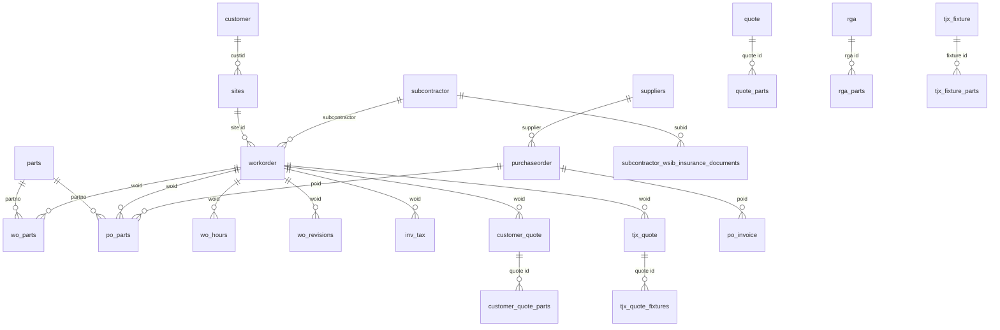

# Data layer — Neon Postgres, Drizzle, and the 175-table legacy contract

**Status:** schema applied to the Neon `production` branch, seed catalogue loaded, no business data.
**Contract:** `green-system/schema.json` v2 (2026-11-11), vendored at
`packages/db/contract/schema.json`.
**Generator:** `pnpm db:generate:schema` → `packages/db/src/schema/legacy/*.ts`.

---

## 1. Two schemas, one database

| Postgres schema | Contents | Owner |
|---|---|---|
| `app` | The rebuild's own tables: users, roles, grants, audit | this repo, hand-written |
| `public` | The legacy mirror: 171 tables from the 175-table contract, exact names | generated from the contract |
| `neon_auth` | Managed Better Auth users, sessions, accounts | Neon Auth |

Keeping the legacy mirror in `public` and the forward model in `app` means a legacy table named
`users` never collides with `app.users`, and migration parity is never compromised by a new
column. The app's `users` is the profile/role/enablement row keyed to Neon Auth; the legacy
`users` row is retained only so migration can read it.

The four tables the rebuild refuses to carry are **not created** (see §7). They are still read
from the old MySQL database by the migration script when needed; the new database has no copy.

### Layout

```
packages/db/
├─ contract/schema.json             vendored authoritative contract (175 tables)
├─ src/schema/app.ts                app.users, permission_definitions, role_permissions,
│                                   user_permissions, audit_log
├─ src/schema/legacy/<domain>.ts    generated: 171 tables, 1,509 columns
├─ src/schema/index.ts              exports ./app and ./legacy/index
├─ src/client.ts                    postgres.js pool, TLS, health probe
├─ src/migrate.ts                   drizzle migrator (direct connection)
└─ src/seed.ts                      permission catalogue + role grants (no business data)
```

Generated exports are prefixed (`legacyWorkorder`, `legacyUsers`, …) while the **database names
are unchanged** (`workorder`, `users`). Use `legacyX` from app code, and the exact name in SQL.

---

## 2. Contract → Postgres type mapping

| MySQL | Postgres / Drizzle | Rule |
|---|---|---|
| `int`, `mediumint` | `integer`; `serial` when `auto_increment` | unsigned is ignored |
| `tinyint`, `smallint` | `smallint`; `smallserial` when auto | `tinyint(1)` is **not** coerced to boolean; raw values are preserved |
| `bigint` | `bigint({ mode: 'number' })`; `bigserial` when auto | |
| `decimal(p,s)` | `numeric(p,s)` | money/rates keep exact precision |
| `float`, `double` | `doublePrecision` | |
| `varchar(n)` | `varchar(n)` | no silent widening |
| `char(n)` | `char(n)` | |
| `text`, `tinytext`, `mediumtext`, `longtext` | `text` | |
| `date` | `date({ mode: 'string' })` | no timezone shift |
| `datetime`, `timestamp` | `timestamp({ withTimezone: false, mode: 'string' })` | legacy wall-clock values preserved |
| `time` | `time` | |
| `year` | `smallint` | |
| `enum(...)` | named Postgres enum `legacy_<table>_<column>` | 17 enums, exact labels including `''` |
| `set(...)` | `text` | none in this contract |

Primary keys, unique keys and indexes are reproduced (168 primary keys, 5 unique, 53 secondary
indexes). **No foreign keys are created**: the legacy engine is MyISAM, the contract documents no
FKs, and migrated rows may not satisfy them. Relationships are enforced by the app layer and
documented in §6.

---

## 3. Quirks honoured in code

| Quirk | Where it shows up |
|---|---|
| `workorder.id` is app-assigned from `wo_next_pid`, **not** auto-increment | `legacy/workorder.ts` JSDoc; column is `integer` PK with no identity/default. Verified: `is_identity = NO`. |
| `inv_tax` money columns are `varchar` | `legacy/invoice.ts` JSDoc; `subtotal_amount`, `tax_amount`, `total_amount` remain `character varying`. No arithmetic in this layer. |
| `parts_salepurchase_log` duplicates one id across `woid_poid`, `invoice_number`, `invoice_id` | `legacy/inventory.ts` JSDoc; all three columns preserved. The app model will use `document_type` + `document_id`. |
| 470 `NOT NULL` columns | reproduced exactly; the 4 excluded tables carried 5 of them, so the mirror has **465** NOT NULL columns. |
| 17 enum columns | named Postgres enums with the exact labels; no text coercion. |
| Typos in legacy names (`is_includeed_in_stock_management`, `localwo_hours_change_histroy`) | preserved in the mirror; corrected only in the app model. |
| `customer` vs `sites` overlap | both mirrored for parity; the app model uses `sites` and treats `workorder.customer` as a site id. |
| Dates stored as `varchar` (`workorder.completiondate`) | preserved as varchar; parsing is a module concern. |

---

## 4. What was migrated

- **171** of the 175 contract tables (the other 4 are excluded, §7).
- **1,509** columns (1,523 contract minus 14 columns in excluded tables).
- **465** `NOT NULL` columns (470 minus 5 in excluded tables).
- **168** primary keys, **5** unique indexes (not `UNIQUE` constraints), **53** secondary
  indexes: **226** indexes in `public`, which is the contract's 229 minus the 3 belonging to the
  excluded tables.
- **17** enum types in `public`, plus `app.user_role`.
- **5** app tables in `app` (46 columns).

Verified on the Neon `production` branch with `information_schema` queries; the exact command is
in §9.

---

## 5. Domain map (the 175 contract tables)

Tables marked **†** are excluded from the mirror; their replacements are in §7.

### identity (1)

`users`

The mirror keeps the legacy row for migration. `app.users` is the forward model and drops
`password`, `mailing_password`, `cls_mailing_password` (do-not-carry #32).

### customer (5)

`customer`, `sites`, `subcontractor`, `subcontractor_contact_info`, `suppliers`

`customer` and `sites` share the Sage `tcustomr.lId` space. `workorder.customer` actually holds a
**site** id in 28,587 of 42,258 rows; use `sites`.

### workorder (18, 17 mirrored)

`localwo_cusprofile`, `localwo_hours`, `localwo_hours_change_histroy`, `localwo_quotes`,
`localwo_sigs`, `localwo_techs`, `wo_ajax_submit`, `wo_hours`, `wo_images_cropped`,
`wo_invoiceno`, `wo_notes`, `wo_parts`, `wo_report`, `wo_revisions`, `wo_soparts`, `wo_tax`,
`workorder`, **`wo_next_pid` †**

### invoice (10)

`inv_hours`, `inv_parts`, `inv_project`, `inv_soparts`, `inv_tax`, `rejected_invoices`,
`sc_inv_hours`, `sc_inv_parts`, `sc_inv_soparts`, `sc_inv_tax`

### quote (26)

`calcquote_hours`, `calcquote_hours_incurred`, `calcquote_incurred`, `calcquote_parts`,
`calcquote_parts_incurred`, `calcquote_report`, `calcquote_soparts`,
`calcquote_soparts_incurred`, `customer_qo_packing_parts`, `customer_qo_packing_slip`,
`customer_qo_packing_soparts`, `customer_quote`, `customer_quote_hours`,
`customer_quote_parts`, `customer_quote_soparts`, `quote_hours`, `quote_hours_incurred`,
`quote_parts`, `quote_parts_incurred`, `quote_report`, `quote_soparts`,
`quote_soparts_incurred`, `standalone_quote`, `standalone_quote_hours`,
`standalone_quote_parts`, `standalone_quote_soparts`

### purchasing (25)

`po_invoice`, `po_invoice_parts`, `po_invoice_soparts`, `po_notification`, `po_parts`,
`po_preorder`, `po_preorder_parts`, `po_preorder_soparts`, `po_preorder_suppliers`, `po_quote`,
`po_quote_requested_parts`, `po_quote_requested_parts_detail`, `po_quote_suppliers`,
`po_soparts`, `po_submission_after_approval`, `po_supplier_quote`,
`po_supplier_quote_parts`, `purchaseorder`, `rga`, `rga_invoice`, `rga_invoice_parts`,
`rga_invoice_soparts`, `rga_notification`, `rga_parts`, `rga_soparts`

### inventory (17)

`parts`, `parts_inventory`, `parts_inventory_adjustment`, `parts_price_history`,
`parts_price_lock`, `parts_purchased_inventory`, `parts_purchasing_log`,
`parts_salepurchase_log`, `parts_selling_log`, `parts_selling_rates`,
`parts_selling_rates_list`, `parts_sub_suppliers`, `parts_supplier_model_rates`,
`parts_supplier_rates`, `parts_supplier_rates_list`, `prf`, `shared_parts_list`

### tjx (21)

`tjx_fixture`, `tjx_fixture_parts`, `tjx_fixture_parts_per_quote`, `tjx_fixture_per_quote`,
`tjx_prices_per_quote`, `tjx_quote`, `tjx_quote_downloads`, `tjx_quote_extra_workorders`,
`tjx_quote_fixtures`, `tjx_quote_lastused_sharedpart`, `tjx_quote_parts`,
`tjx_quote_revisions`, `tjx_quote_soparts`, `tjx_room`, `tjx_rooms_template`,
`tjx_sub_invoice`, `tjx_sub_invoice_fixtures`, `tjx_sub_invoice_revisions`,
`tjx_subcontractor_rates`, `tjx_wo_parts`, `tjx_wo_soparts`

`tjx_rooms_template` is live despite the `_temp` pattern; the contract overrides the classifier.

### compliance (13)

`material_checklist`, `material_checklist_custom_entries`, `material_checklist_defective_parts`,
`material_checklist_notes`, `material_checklist_parts`,
`material_checklist_returning_custom_enteries`, `material_checklist_returning_parts`,
`material_warranty`, `site_activity_logs`, `site_address_change_log`, `site_warranty`,
`subcontractor_additional_documents`, `subcontractor_wsib_insurance_documents`

### messaging (7)

`customer_emails`, `email_messages_to_sub`, `messages`, `messages_links`, `messages_links_po`,
`sub_stock_messages`, `sub_stock_notification`

### lookup (20, 19 mirrored)

`customer_quote_payterms`, `customer_quote_status`, `message_setup`, `parts_group`,
`permission_type`, `po_preorder_status`, `po_priority`, `po_quote_request_status`,
`po_quote_submitted_status`, `po_status`, `rga_status`, `standalone_quote_status`,
`tjx_quote_grid_types`, `tjx_quote_payterms`, `tjx_quote_status`, `wo_categories`,
`wo_priority`, `wo_servtype`, `wo_status`, **`settings` †**

### technical (12, 10 mirrored)

`api_sc_callback_url_response`, `api_sc_status_webhook`, `api_sc_webhook`,
`cron_run_history`, `errors_log_info`, `rejected_quotes`, `servchannel_api_setting`,
`signoff_cron`, `undispatched_batch_upload`, `undispatched_workorders`,
**`user_permissions` †**, **`user_permissions_price_management` †**

---

## 6. Relationships at a glance



The database does not enforce these (no FKs). Module code joins on the documented keys and the
`DATA-DICTIONARY.md` FK map is the authority for column-level relationships.

Dependency direction for build order:

```
lookup → customer/parts → workorder/quote → purchasing → invoice → tjx/messaging/compliance
```

Work Orders is first because `workorder` is the hub: quote, purchasing, invoice and TJX all hang
off it.

---

## 7. Do-not-carry: tables excluded from the new schema

| Legacy table | Why it must not survive | Replacement |
|---|---|---|
| `user_permissions` | one fact, two permission stores; rows unrecoverable | `app.user_permissions` — one grant store with `is_allowed`, `expires_at`, `scope_subcontractor_id` |
| `user_permissions_price_management` | second grant table for the price editor; rows unrecoverable | permission key `inventory:edit_price` granted in `app.user_permissions` |
| `settings` | configuration stored as business data (`FieldName`/`FieldValue`) | typed environment/config (`@cls/core/env.server`) and, when a runtime-editable setting is needed, a typed `app.settings` table — never free text |
| `wo_next_pid` | read-then-increment id counter; race loses numbers | a Postgres sequence (or identity) for new work orders, with retry on conflict; the mirror keeps `workorder.id` app-assigned for legacy parity |

All other do-not-carry entries are **column or behaviour** exclusions, applied when the app model
is written for each module:

- credentials: `users.password`, `users.mailing_password`, `users.cls_mailing_password` are not
  read into `app.users`; identity is Neon Auth, mail credentials are configuration.
- money as varchar: `inv_tax.*_amount`, `po_invoice_tax.appliedtaxrate`, `entered_rate`,
  `parts_selling_rates.*` become `numeric` in the app model.
- frozen comparison columns: `purchaseorder.status_on_july_21_2025`,
  `shipment_type_bkup_18july2025` stay in the mirror, never in the app model; use history rows.
- derived/duplicate tables (`parts_current_stock_total*`, `*_without_wsib_insurance`,
  `po_status_v2`, 117 dated copies, 3 test shadow tables) were already outside the 175 contract
  and are not created.

The full 36-row rationale is the cartographer's `DATA-DICTIONARY.md` §"Do-not-carry list"; this
table records only the four **table-level** exclusions from the contract.

---

## 8. Business data and fixtures

**No business rows were loaded.** The only seed is the platform catalogue:

```
pnpm db:seed
  → 30 permission_definitions
  → 49 role_permissions
  → 0 users (SEED_ADMIN_EMAIL is unset; set it explicitly for a new install)
```

Dev fixtures must live in a separate path and never run against `production`. The intended
layout is `packages/db/src/fixtures/` with an explicit `pnpm db:fixtures` command and a guard that
refuses `NODE_ENV=production`. Fixtures are not created yet; module agents add their own when
their tables land.

The 77 InnoDB tables with unrecoverable rows are mirrored as definitions only. Do not invent rows
for them; the migration notes classify what can be recovered.

---

## 9. Verification

Regenerate and apply:

```bash
pnpm db:generate:schema     # contract → packages/db/src/schema/legacy/*.ts
pnpm db:generate            # Drizzle snapshot → packages/db/drizzle/*.sql
pnpm db:migrate             # uses DATABASE_URL_UNPOOLED
pnpm db:seed                # catalogue only
```

Counts were checked directly against the Neon `production` branch:

```sql
select count(*) from information_schema.tables
 where table_schema = 'public' and table_type = 'BASE TABLE';   -- 171
select count(*) from information_schema.columns
 where table_schema = 'public';                                  -- 1509
select count(*) from information_schema.columns
 where table_schema = 'public' and is_nullable = 'NO';           -- 465
select count(*) from information_schema.table_constraints
 where table_schema = 'public' and constraint_type = 'PRIMARY KEY'; -- 168
select count(*) from pg_indexes where schemaname = 'public'
 and indexdef not like '%UNIQUE%';                               -- 53 secondary
select count(*) from pg_indexes where schemaname = 'public'
 and indexdef like 'CREATE UNIQUE INDEX%'
 and indexname not in (select conname from pg_constraint
   where contype = 'p' and connamespace = 'public'::regnamespace); -- 5 unique, not constraints
select count(*) from pg_indexes where schemaname = 'public';      -- 226 total
select count(*) from pg_type t join pg_enum e on e.enumtypid = t.oid
 join pg_namespace n on n.oid = t.typnamespace
 where n.nspname = 'public' and t.typtype = 'e';                  -- 17 enum types
```

Quirk checks:

```sql
select is_identity, column_default from information_schema.columns
 where table_schema='public' and table_name='workorder' and column_name='id';
-- is_identity = NO, column_default = null

select column_name, data_type from information_schema.columns
 where table_schema='public' and table_name='inv_tax' and column_name like '%amount%';
-- all character varying
```

Contract accounting:

```
175 authoritative tables
 - 4 do-not-carry tables
 = 171 mirrored
 + 5 app tables
 = 176 tables in the new database (public + app)
```

Column accounting:

```
1,523 contract columns
 - 14 columns in the 4 excluded tables
 = 1,509 mirrored
 + 46 app columns
 = 1,555 columns owned by the rebuild
```

`neon_auth` tables are provider-owned and excluded from these counts.

---

## 10. Rules for module agents

1. Never edit `src/schema/legacy/*.ts`; update the contract and run the generator.
2. Add app tables to the domain file in `src/schema/app/` (split `app.ts` when it grows) using the
   `app` schema, not `public`.
3. Use `legacyX` exports for reads during migration; do not join app tables to legacy tables in a
   write path.
4. Every new app table gets its own migration; never edit an applied migration.
5. Keep money `numeric`, timestamps `timestamptz`, and identifiers `uuid` in the app model.
6. Do not create foreign keys against the legacy mirror.
